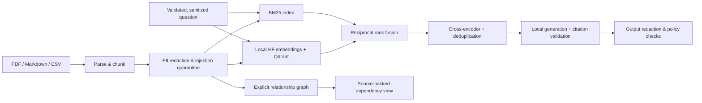

<div align="center">

# IncidentLens
### Evidence before action.

A local incident investigation demo that turns runbooks and postmortems into **cited answers, traceable dependencies, and measurable retrieval**.

**Hybrid RAG · Open reranking · Knowledge graphs · PII guardrails · Automated evaluations**

[Quick start](#quick-start) · [Demo walkthrough](docs/DEMO_SCRIPT.md) · [Architecture](docs/ARCHITECTURE.md) · [Evaluation](docs/EVALUATION.md) · [Security](docs/SECURITY.md)

</div>

---

## The demo story

> “Checkout is timing out with PAY-504. What should we investigate, and who owns the dependency?”

IncidentLens searches a fictional commerce platform's runbooks and incident reports, reranks the evidence, traces service dependencies, and produces a cited investigation brief. It separates historical incident facts from conclusions about a new outage. It has no access to live infrastructure and cannot execute recovery actions.

Four views make the system inspectable:

- **Investigation:** grounded responses, source citations, query safety outcomes, and latency.
- **Knowledge map:** explicit service dependencies and ownership relationships, each linked to a source sentence.
- **Evaluation lab:** vector-only vs hybrid vs reranked retrieval, question-level results, and safety failures.
- **Document library:** Markdown, text, legacy CSV, and PDF ingestion with parser and page metadata.

## Quick start

Requires Python 3.12 or 3.13, internet access for initial dependencies/model downloads, and disk space for approximately 3–5 GB of models plus the Python environment. An Apple Silicon Mac or a modern CPU machine can run the demo. The small generator prioritizes accessible local execution over answer quality.

```bash
git clone https://github.com/raghavpamnani/incidentlens-week3.git
cd incidentlens-week3
bash scripts/setup.sh
source .venv/bin/activate
uvicorn incidentlens.main:app --host 127.0.0.1 --port 8030
```

Open **http://127.0.0.1:8030**. API documentation is at **/docs**. First generation loads the local LLM and is slower than subsequent queries. Use one server worker: embedded Qdrant owns a filesystem lock.

The full setup enables **Docling**, **Presidio with spaCy NER**, and **Qwen2.5-0.5B-Instruct**. The checked-in `.env.example` describes available settings. Existing `.env` files are preserved.

### Lightweight / evidence-only profile

```bash
python3 -m venv .venv
source .venv/bin/activate
pip install -e '.[dev]'
cp .env.example .env
python scripts/build_index.py
uvicorn incidentlens.main:app --host 127.0.0.1 --port 8030
```

This profile still uses real local embeddings, Qdrant, BM25, and a cross-encoder. It uses **pdfplumber** for text PDFs, pattern-based Presidio PII recognizers without name NER, and **extractive evidence excerpts**, clearly labeled in the UI. It does not perform LLM generation or HyDE. Do not present this profile as the full RAG generation demo.

### Optional Ollama and Llama Guard

Set `IL_GENERATOR=ollama` and configure `IL_OLLAMA_MODEL` to a locally installed instruction model. Set `IL_LLAMA_GUARD_MODEL` only when that safety model is installed in Ollama. An unavailable configured classifier fails closed. Llama Guard is an optional integration; it is not needed for the default profile and is not claimed as verified by the included benchmark.

## Pipeline



HyDE optionally generates a hypothetical retrieval passage; it is never treated as source evidence. The original question still drives keyword search. The graph view complements retrieval; this implementation does not claim a graph-trained model or general-purpose GraphRAG.

## Models and components

| Component | Implementation |
| :--- | :--- |
| Embeddings | `sentence-transformers/all-MiniLM-L6-v2`, local CPU inference |
| Vector storage | Qdrant embedded, cosine distance |
| Keyword retrieval | BM25 with identifiers preserved as tokens |
| Fusion | Reciprocal rank fusion, k=60 |
| Reranking | `cross-encoder/ms-marco-MiniLM-L-6-v2`, local CPU inference |
| Generation | Qwen2.5-0.5B-Instruct via Transformers; optional Ollama |
| PDF parsing | Docling full profile, OCR disabled for the supplied text PDF; explicit pdfplumber profile |
| Knowledge graph | NetworkX MultiDiGraph; explicit `depends on` / `is owned by` sentences |
| PII & secrets | Presidio + spaCy NER in full profile; custom email and API-key recognizers |
| Faithfulness estimate | Optional NLI cross-encoder, disclosed as an estimate |
| Interface / API | Self-contained HTML/CSS/JavaScript + modular FastAPI routes |

## Verify the project

```bash
pytest -q
ruff check incidentlens scripts tests
python scripts/evaluate.py
# Stop the server first: Qdrant local storage can be opened by one process.
python scripts/evaluate.py --with-answers
```

The versioned [question set](evaluation/questions.json) is authored and reviewed against the synthetic corpus. [Saved results](evaluation/results.json) contain real run data, model/configuration details, corpus/dataset fingerprints, and question-level outcomes. See [methodology and limits](docs/EVALUATION.md). Model-assisted faithfulness is not verified correctness.

`python scripts/generate_eval.py` generates **candidate** synthetic Q&A with a schema and validated source IDs. Candidates are explicitly marked as requiring review; they do not automatically become ground truth.

## Week 3 coverage

| Day | Implemented evidence |
| :--- | :--- |
| 11 | Validated CSV parser; heading-aware overlapping chunks; Docling PDF table parsing; page provenance; HF embeddings; Qdrant; hybrid search |
| 12 | Cross-encoder reranking; rank inspector; context deduplication; optional HyDE |
| 13 | Explicit entity/relationship extraction; bounded NetworkX traversal; source-backed edges |
| 14 | Reviewed dataset; precision/recall/MRR; consistent ablation benchmark; latency; NLI answer estimates; candidate dataset generation |
| 15 | Pydantic boundaries; input/output checks; PII and secrets redaction; injection fixture quarantine; optional Llama Guard |

## Project structure

```text
incidentlens/
  api/              # HTTP contracts, source lookup, document ingestion
  config.py         # Explicit runtime profiles
  models.py         # Typed documents, hits, graph edges and answers
  parsing.py        # PDF / Markdown / CSV adapters and chunking
  retrieval.py      # Embeddings, Qdrant, BM25, fusion and reranking
  graph.py          # Conservative extraction and provenance
  guardrails.py     # Presidio, policy checks, optional Llama Guard
  generation.py     # Local LLM / Ollama / explicit extractive profile
  pipeline.py       # Investigation orchestration
  evaluation.py     # Metrics and NLI estimation
  static/           # Responsive interface without external JS
corpus/             # Fictional sample documents only
scripts/            # Setup, indexing, evaluation, sample PDF generation
 tests/             # Automated unit and API boundary checks
```

## Scope and honesty

This is a **single-user localhost bootcamp demo**, not a production incident-management service. It has no authentication, tenant isolation, automatic remediation, or live telemetry. Prompt injection patterns and PII detection are imperfect; the system makes no compliance guarantee. A citation can exist without supporting a claim. The tiny local LLM may fail JSON validation or generate weak answers; failures are surfaced instead of silently substituted. Deployment would require authentication, isolation, resource controls, stronger evaluation, and additional threat modeling.

The source documents deliberately include fictional PII, a fake API key, and a malicious instruction fixture. Those fixtures are for testing. Never upload real private or client documents to a public demo repository.

## Submission materials

- [Two-minute walkthrough](docs/DEMO_SCRIPT.md)
- [Architecture and decisions](docs/ARCHITECTURE.md)
- [API contracts and curl examples](docs/API.md)
- [Security behavior and limitations](docs/SECURITY.md)
- [Evaluation methodology](docs/EVALUATION.md)
- [Requirement-to-evidence checklist](docs/SUBMISSION.md)

Built by [Rahul Pamnani](https://github.com/raghavpamnani) as a separate AI Bootcamp Week 3 project.
